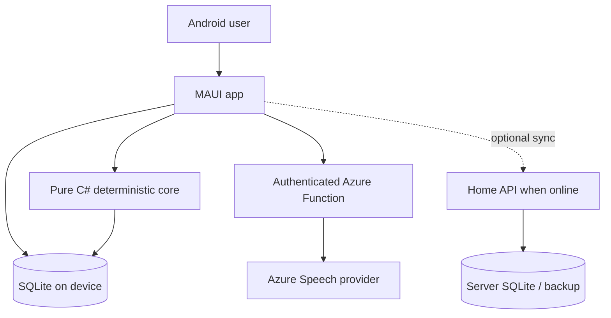

# Architecture — MVP v0.1

## Context

## Logical modules
- Mobile: screens for Today, Workout, Speak/Confirm, Measurements, Food, Restrictions, Progress, Settings/Privacy.
- Core.Domain: Exercise, Session, Set, Food, Symptom, RestrictionPolicy, Recommendation, AuditEvent.
- Core.Application: commands, validation, recommendations orchestration, deterministic parser, progression.
- Analytics: averages, rolling medians, trend quality, estimated ranges, rule-versioned suggestions.
- Infrastructure.Mobile: SQLite, migrations, secure storage, background sync queue and voice capture.
- Speech.Contracts: normalized transcription envelope and provider interface.
- Cloud.SpeechProxy: authenticated Azure Function; checks consent token, size, quotas and provider credentials; returns transcript with metadata.
- Infrastructure.Server (optional): sync API, idempotent event ledger and encrypted backup. Not required for MVP launch.

## Data flow
1. User taps record and sees provider/privacy disclosure. Device captures bounded audio only after consent.
2. With Internet and remaining quota, app obtains authenticated short-lived request via proxy. Proxy delegates STT, returns text, does not keep raw audio by default.
3. If unavailable or declined, user types or saves pending audio locally with explicit retention consent. No automatic transmission later without consent.
4. Pure parser extracts entities, preservation of original transcript, ambiguity flags; user validates numbers before commit.
5. Local database commits activity event transactionally. Analytics/restriction policies can run without cloud.
6. Weekly analyzer emits recommendations in pending state, requiring user approval.

## Dependency rules
Mobile -> Application/Domain; Adapters -> Contracts; Analytics -> Domain. Domain cannot reference MAUI, Azure SDK, or SQLite. Never let a speech provider mutate workout plans.

## Persistence
Source events append-only with UUID, schema_version, recorded_at_utc, offset, captured_by (manual/voice/import), status and user override fields. Projections are replaceable; exercise plan version snapshots are immutable per workout.

## Security
Serverless proxy is authenticated and rate limited; don't embed Azure keys in APK. Avoid public API and public health logs; build testing with synthetic personas. Offline secrets use Android Keystore. Data exports should be user-controlled, with encryption option.

## Deployment
No 24/7 VM. Local Android primary. Azure Function consumption plan *subject to provider availability, billing eligibility and observed limits*. Optional domestic server can wake/sync when available.

## Performance and reliability
Use short recordings, streaming or chunked uploads as supported; degrade to manual input; implement exponential backoff only for transient server failures with explicit authorization for re-send. No energy estimation treated as precise measurement.
